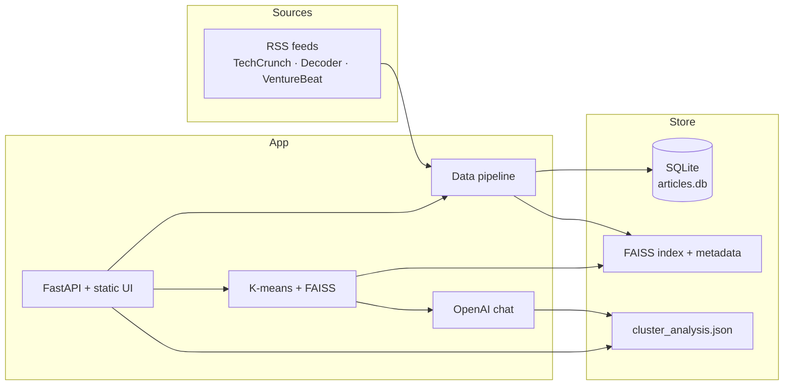

# Tech Market Trend Analyzer

A small research tool that turns recent tech and AI news into grouped market insights.

It reads public RSS feeds, keeps unique articles, embeds the text, clusters related stories, and asks a language model to describe each cluster: what is happening, which views differ, and which moves look strategic.

The end result is a dashboard you can open in a browser — not a spreadsheet of headlines.

---

## Who it is for

- Analysts and students who want a structured view of this week’s AI and tech news
- Founders and PMs who need a quick briefing before a market conversation
- Anyone who currently skims several feeds and then writes the summary by hand

---


## What it does


| Step        | What you get                                                                 |
| ----------- | ---------------------------------------------------------------------------- |
| **Collect** | Articles from TechCrunch, The Decoder, and VentureBeat’s AI feed             |
| **Filter**  | Keeps items that look like AI, startups, or platform news; drops duplicates  |
| **Store**   | SQLite, one row per URL                                                      |
| **Embed**   | OpenAI embeddings of the article body                                        |
| **Cluster** | K-means over FAISS vectors so related stories sit together                   |
| **Analyze** | A JSON briefing per cluster (title, developments, trends, viewpoints, moves) |
| **Show**    | A homepage plus a dashboard that pages through those briefings               |


The homepage is the landing screen. **View Market Analysis** opens the dashboard. The first run has to fetch and analyze articles before the dashboard has anything to show.

---


## How a typical run works

```text
Start the web app
    → Open the dashboard
        → Start (or wait for) the data pipeline
            → RSS fetch → clean → embed → cluster → LLM briefing
                → Dashboard shows one card per topic cluster
```

You can also run the pipeline from the command line (`python main.py`). That version keeps a 24-hour refresh loop until you stop it.

---


## Architecture




```text
Browser  →  FastAPI (PORT, default 8001 in this checkout)
                →  SQLite (db/articles.db)
                →  FAISS (faiss/)
                →  OpenAI (embeddings + cluster write-up)
```

**Request path.** The browser loads HTML from FastAPI. The dashboard calls `/api/analysis`. If a cached briefing exists it is returned immediately; otherwise clusters are built and sent to the chat model.

**Pipeline path.** `/api/pipeline/run` (or `python main.py`) fetches RSS, stores new URLs, embeds full text, and writes the FAISS index.

---


## Technology


| Layer   | Choice                                    |
| ------- | ----------------------------------------- |
| Website | HTML, CSS, vanilla JavaScript             |
| API     | Python 3.10+, FastAPI, Uvicorn            |
| Store   | SQLite                                    |
| Vectors | FAISS (`faiss-cpu`), scikit-learn K-means |
| LLM     | OpenAI embeddings + chat                  |
| Ingest  | feedparser, newspaper3k, BeautifulSoup    |


---


## Project layout

```text
tech_market_trend_analyzer/
├── app.py                 Web API and static pages
├── main.py                CLI pipeline + 24-hour scheduler
├── views.py               Cluster → LLM briefing for the dashboard
├── data/                  RSS fetch, scrape, clean, SQLite writes
├── db/                    Connection helpers
├── vector_store/          OpenAI embeddings
├── agent/                 Clustering and analysis prompt
├── frontend/              Homepage and dashboard
├── setup.md               Step-by-step local setup
└── .env.template          Keys and tunables
```

---


## Getting started

Install, API key, first run, and a working checklist are in **[setup.md](setup.md)**.

The short version:

```bash
cd tech_market_trend_analyzer
python3.12 -m venv market_env   # python3 -m venv if that is already 3.10+
source market_env/bin/activate   # Windows: market_env\Scripts\activate

pip install -r requirements.txt
cp .env.template .env
# Add OPENAI_API_KEY. Keep PORT=8001 if Career Intelligence is already on 8000.

python app.py
```

Then open [http://localhost:8001](http://localhost:8001) (or the port you set). The site loads without a key. Fetching articles, embeddings, and cluster write-ups need `OPENAI_API_KEY`.[p](https://github.com/prashere/tech_market_trend_analyzer)

---

